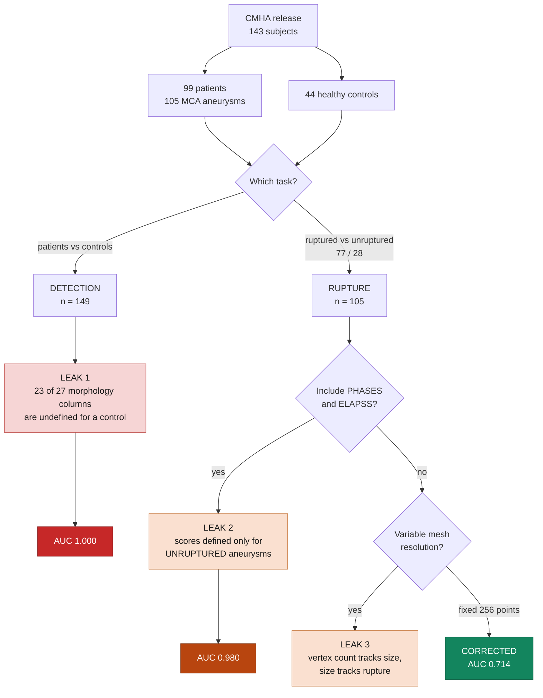
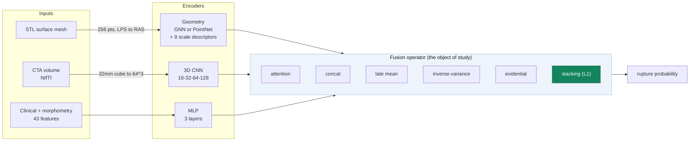
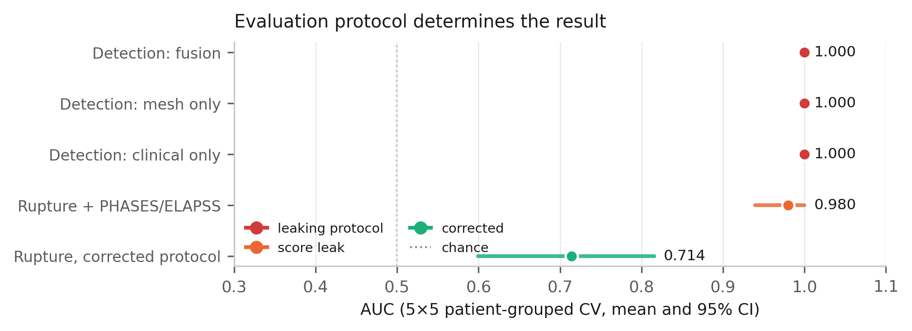
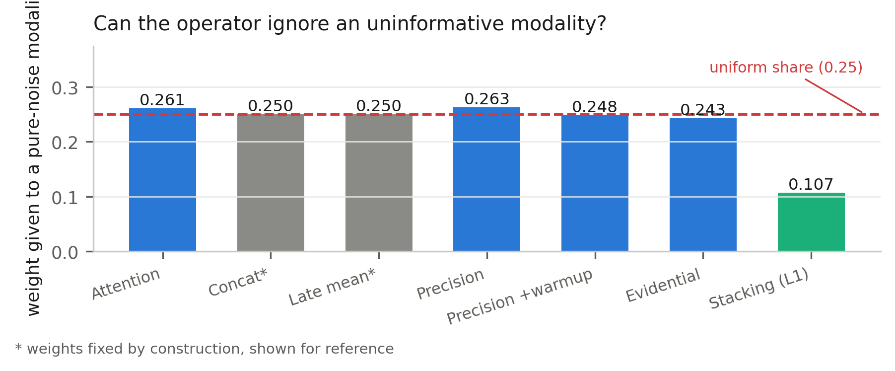
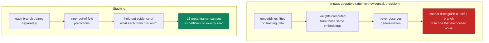

# Three Ways to Get AUC 1.000 on a Medical Dataset Without Learning Anything

[](https://www.python.org/)
[](https://pytorch.org/)
[-brightgreen)](https://doi.org/10.1038/s41597-024-04056-8)
[](LICENSE)

A leakage audit and corrected benchmark for **intracranial aneurysm rupture prediction**
on [CMHA](https://doi.org/10.1038/s41597-024-04056-8), a multimodal CT-angiography dataset
released in 2024.

This project started as a conventional multimodal fusion paper. It reported ~90% accuracy
and AUC ≈ 1.00. Those numbers were **real outputs of a real pipeline**, and they were
**entirely artifacts of the evaluation protocol**. This repository contains the audit that
established why, the corrected protocol, and an honest benchmark.

---

## TL;DR

| | AUC |
|---|---|
| Detection framing (patients vs. controls), all modalities | **1.000 ± 0.000** |
| Detection framing, **surface mesh alone** | **1.000 ± 0.000** |
| Rupture task with PHASES/ELAPSS risk scores as features | **0.980 ± 0.011** |
| **Rupture task, corrected protocol** | **0.714 ± 0.035** |

Same architecture. Same data. Same code. The difference is the protocol.

A second finding, independent of the dataset: given a modality consisting of **pure Gaussian
noise**, softmax attention, concatenation, evidential and inverse-variance fusion all assign
it roughly its uniform share of the weight. **Stacked generalisation does not.**

---

## The three leakage sources



### Leak 1 — control inclusion is *provably* unfair

The released morphology table has **27 descriptors** for patients and **6** for controls.
Twenty-three of them (neck width, aneurysm volume, aspect ratio, ellipticity, undulation…)
describe an aneurysm and have **no definition** for a subject who does not have one.

Any joint design matrix must impute those 23 columns for every control. Whatever value is
chosen is constant across controls and absent from patients — a perfect class indicator.
**No imputation strategy avoids this**, because the need to impute *is* the signal.

The same holds for the other modalities: patients supply an aneurysm surface (mean bounding
radius **4.2 mm**), controls supply a healthy artery segment (**8.6 mm**). Bounding radius
alone separates the groups at **AUC 0.929 with no training at all**.

### Leak 2 — risk scores as input features

PHASES and ELAPSS ship in the same CSV as age and blood pressure, so treating them as
features is the obvious move. Both are defined *for unruptured aneurysms*. In this cohort
`ELAPSS >= 5` alone reaches **95.2% accuracy**. They belong in the baseline column, not the
feature matrix.

### Leak 3 — graph cardinality encodes size

Meshes range from **229 to 22,296 vertices**. Vertex count tracks aneurysm size, size tracks
rupture — so a graph encoder can read the label off the cardinality of its own input.
Fixed 256-point sampling removes this; a *global* (not per-sample) coordinate normalisation
keeps real millimetre scale available to the encoder.

---

## Architecture



---

## Corrected benchmark

5 × 5 repeated stratified **patient-grouped** cross-validation, n = 105 aneurysms (77 ruptured / 28 unruptured).

| Model | AUC | 95% CI | AUPRC | MCC | perm. *p* |
|---|---|---|---|---|---|
| Geometry (GNN) | 0.486 ± 0.058 | 0.368–0.609 | 0.750 | 0.117 | 0.335 |
| Clinical + morphometry | 0.565 ± 0.024 | 0.438–0.692 | 0.766 | 0.189 | 0.099 |
| **Imaging (3D CNN)** | **0.714 ± 0.035** | **0.599–0.815** | **0.867** | **0.341** | **<0.001** |
| Geometry + imaging | 0.682 ± 0.034 | 0.568–0.787 | 0.849 | 0.317 | <0.001 |
| Imaging + clinical | 0.567 ± 0.068 | 0.446–0.683 | 0.790 | 0.209 | 0.002 |
| Geometry + clinical | 0.524 ± 0.051 | 0.401–0.645 | 0.752 | 0.187 | 0.288 |
| Attention fusion (all three) | 0.602 ± 0.059 | 0.486–0.720 | 0.803 | 0.240 | 0.001 |

**Every modality added to imaging makes it worse.** 0.714 → 0.682 → 0.602.
No fusion configuration beats the best single modality.

Calibration is poor throughout (Brier ≈ 0.25), which is **worse than the 0.196 of a trivial
base-rate predictor**. These models discriminate weakly; they do not produce usable
probabilities. Reported as such.



---

## Can a fusion operator ignore a useless modality?

A fourth branch is added whose input is a **fixed per-sample Gaussian vector** — zero
information by construction. Any weight it receives is weight misallocated. For four
modalities the uniform share is 0.250.

| Operator | w(noise) | vs uniform | zeroed |
|---|---|---|---|
| Attention over embeddings | 0.261 | 1.04× | — |
| Inverse-variance weighting | 0.263 | 1.05× | — |
| Evidential (Dempster–Shafer) | 0.243 | 0.97× | — |
| Concatenation / late mean | 0.250 | 1.00× | *fixed* |
| Stacking, L2 meta-learner | 0.138 | 0.55× | 0% |
| **Stacking, L1 meta-learner** | **0.107** | **0.43×** | **36%** |



### Why



The L1 meta-learner's mean coefficients track true branch quality:

| branch | coefficient | solo AUC | zeroed in |
|---|---|---|---|
| Imaging | **0.731** | 0.709 | 0% of folds |
| Clinical | 0.106 | 0.500 | 24% |
| Geometry | −0.111 | 0.486 | **36%** |
| Pure noise | −0.098 | chance | **36%** |

Geometry and pure noise are discarded at **identical rates** — which is correct. Geometry is
statistically at chance on this cohort, so it *is* as uninformative as noise. The operator
detects uninformativeness; it has no obligation to know which branch is synthetic.

**Honest caveat:** stacking still does not beat imaging alone (0.657 vs 0.709, DeLong
p = 0.099), and fixed-weight averaging matches L1 on AUC (0.661). What the weighting buys is
**correct attribution**, not better discrimination.

---

## Engineering notes worth reading

Three bugs found here were silent — the pipeline ran clean and produced plausible numbers.

**1. STL and NIfTI do not share a coordinate frame.** Surface models are DICOM/**LPS**; the
NIfTI affine maps to **RAS**. The correct mapping is `voxel = A⁻¹·(−x, −y, z, 1)ᵀ`. Verified
empirically by the fraction of interior mesh points landing in the contrast-enhanced lumen
window (150–700 HU):

| sign convention | contrast fraction |
|---|---|
| **(−1, −1, 1)** | **0.48 / 0.75 / 0.67** |
| every alternative | ≤ 0.30 |

The identity mapping puts the mesh on **skull bone (~830 HU) or air**. The model still trains
without error — on meaningless voxels. Cohort-wide contrast fraction after the fix: **0.918**.

**2. BatchNorm destroys absolute scale.** Applied to node features it standardises across the
batch, and scale is where most of the geometric signal lives (`r_max` 0.642, `eig3` 0.634
univariate AUC). Nine scale-bearing global descriptors are concatenated after pooling.

**3. Two different estimators, one number.** Averaging per-repeat AUCs and bootstrapping the
repeat-*averaged* predictions measure different things — the latter is an ensemble and scores
higher. Reporting a per-repeat point estimate beside a pooled CI produced the impossible
`AUC 0.702, CI [0.742, 0.929]`. Both are now computed and labelled separately.

---

## Protocol rules

> These are not stylistic preferences. Each one, relaxed, changes the headline number.

- **Group by patient — including in the inner loop.** Six patients contribute one ruptured
  *and* one unruptured aneurysm. An ungrouped split puts identical clinical vectors on both
  sides with opposing labels.
- **PHASES / ELAPSS are baselines, never inputs.**
- **Hyperparameters fixed a priori.** At n = 105, tuning on evaluation folds voids the result.
- **Never pair a per-repeat point estimate with a pooled CI.**

---

## Repository layout

```
src/
  prep_tabular.py            clinical + morphometric features, leakage controls
  prep_mesh_vol.py           STL to point cloud, CTA to 64^3 (LPS to RAS fix)
  prep_controls.py           detection-task matrices (leak quantification)
  prep_detection_imaging.py  mesh/volume tensors for the detection task
  model.py                   GNN / 3D CNN / MLP encoders, attention fusion
  model2.py                  PointNet encoder, 5 fusion operators, noise branch
  metrics.py                 bootstrap CIs, DeLong, permutation tests, calibration
  train_cv.py                11-config suite, patient-grouped repeated CV
  fusion_study.py            geometry encoders, noise control, operator sweep
  stacking.py                stacked generalisation with L1/L2 meta-learners
  diag_fusion.py             entropy-regulariser and weak-branch ablations
  make_figures2.py           publication figures (PDF + PNG) and LaTeX tables
hpc/                         SLURM + enroot: self-probing GPU setup for a DGX A100
data/processed/              small preprocessed tensors (see note below)
results/ results_fusion/     per-config JSON + out-of-fold predictions
figs/                        figures and tables
```

**Deliberately no `torch_geometric`.** The GNN uses a dense normalised adjacency in plain
PyTorch, so there are no wheel/CUDA version mismatches on a cluster.

---

## Reproducing

```bash
pip install -r requirements.txt
```

The two CTA tensors (`volumes.npy`, `volumes_detection.npy`, 127 MB) are **not** in this
repo. Everything else needed is. To regenerate them:

1. Download CMHA from [figshare](https://doi.org/10.6084/m9.figshare.26965450) (CC BY, ~15.6 GB)
2. Extract `patients.rar` and `controls.rar` to `data/raw/extracted/`
3. ```bash
   python src/prep_tabular.py
   python src/prep_mesh_vol.py
   python src/prep_controls.py
   python src/prep_detection_imaging.py
   ```

Then run any stage:

```bash
python src/train_cv.py --all      # 11-config suite + leakage quantification
python src/fusion_study.py --all  # geometry encoders, noise control, 5 operators
python src/stacking.py --all      # stacked generalisation
python src/make_figures2.py       # figures and tables
```

Every stage is **resumable** — a finished configuration is skipped on re-run. Cost knobs
(`CMHA_N_REPEATS`, `CMHA_EPOCHS`, `CMHA_EPOCHS_BRANCH`) trade repeats for wall-clock on
slower hardware. Defaults reproduce the reported numbers.

Full suite: **~5 h on one A100 MIG partition**. It is overhead-bound rather than FLOP-bound
(105 samples), so a faster GPU helps less than you would expect.

### On the HPC scripts

`hpc/run_dgx.sbatch` probes seven enroot GPU configurations and uses the first where a real
allocation on `cuda:0` succeeds. This is not over-engineering: `torch.cuda.is_available()`
returns `True` in a configuration that later dies with
`device >= 0 && device < num_gpus INTERNAL ASSERT FAILED`, so the probe performs an actual
allocation and matmul.

---

## Data and citation

Dataset: Song, M., Wang, S., Qian, Q., Zhou, Y., Luo, Y., Gong, X. **Intracranial aneurysm
CTA images and 3D models dataset with clinical, morphological and hemodynamic data.**
*Scientific Data* **11**, 1213 (2024). [doi:10.1038/s41597-024-04056-8](https://doi.org/10.1038/s41597-024-04056-8) — CC BY.

Preprocessed tensors in `data/processed/` are derivatives of that release and carry the same
licence. Code in this repository is MIT.

This work was presented at **CISCOM 2026** and appears in the conference proceedings:

> Chandra, S., Rangisetti, L.P., Nelabhotla, A., Priyadarshini: **How Evaluation Protocol and
> Fusion Operator Shape Reported Performance in Multimodal Aneurysm Rupture Prediction.**
> In: *Proceedings of CISCOM 2026*, Communications in Computer and Information Science,
> Springer (2026).

<!-- TODO: add volume, page range and DOI once the proceedings are indexed. -->


---

## Limitations

105 aneurysms from 99 patients, single centre, middle cerebral artery only. Confidence
intervals are wide and several differences discussed above are not individually significant.
Calibration is poor for every model. For six two-aneurysm patients the mapping from clinical
rows to surface files is positional and unverifiable from geometry, affecting 12 of 105
labels. Run-to-run variation across GPU nodes is ≈0.01 AUC on geometry-bearing
configurations; all reported numbers come from a single run.
